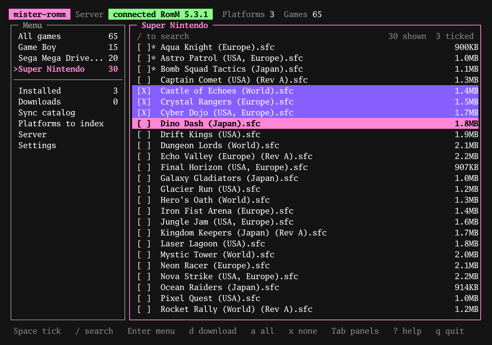
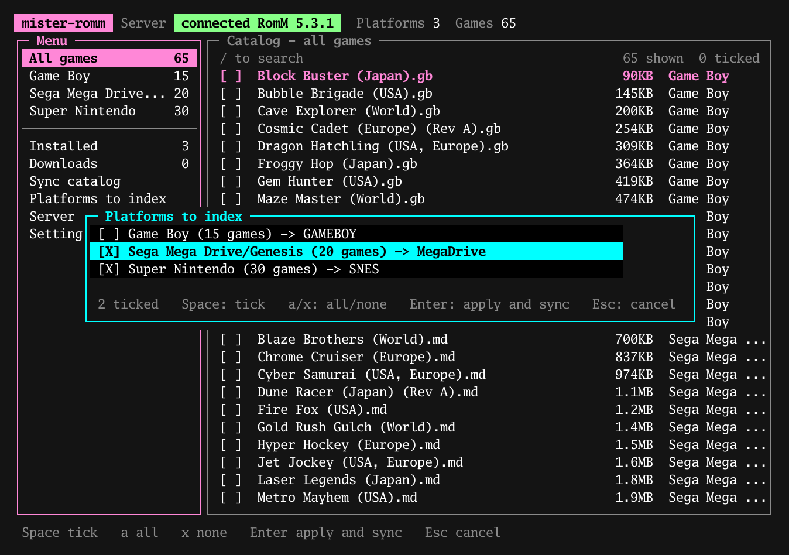
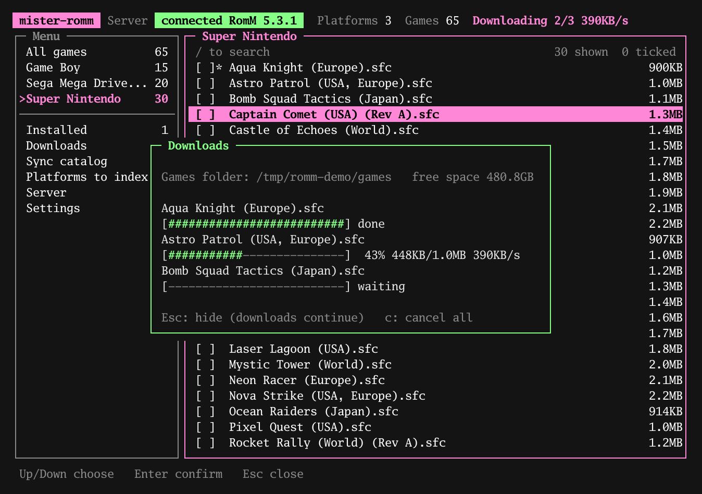
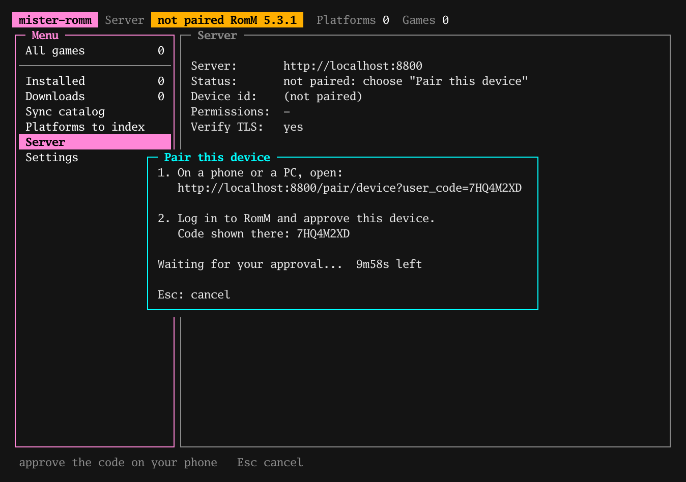
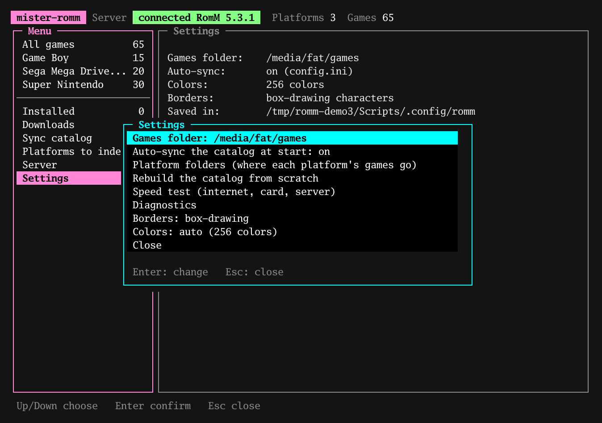

# mister-romm: a RomM client for MiSTer FPGA

**Browse your self-hosted [RomM](https://github.com/rommapp/romm) ROM library and download games straight onto your
MiSTer FPGA**, from the console itself, with no PC in between.

mister-romm is a small terminal application (a single static ARM binary, nothing to install) that connects a MiSTer to
a RomM server. Pair it once, sync the game list of your platforms, search it, and download the games you pick into the
right core folders (SNES, Game Boy, Mega Drive and so on). It is meant for retro gaming setups where the ROM collection
lives on a home server and the MiSTer should simply fetch what you want to play.

  

## Features

- **Pairing** from a phone (or with a code): no password to type on the MiSTer
- **Local catalog**: the list of games of your platforms is synced (incrementally), then you choose what to download
- **Search** the whole catalog instantly, even with tens of thousands of games
- **Downloads** with resume, size and sha1 verification, free-space check and cancellation
- **Management**: delete the games you downloaded, choose the destination folder of each platform
- **Tools**: diagnostics, speed test, automatic clock setting (`ntpd`) and built-in HTTPS certificates, which matter on a MiSTer without a battery-backed clock
- A single **static** binary (ARMv7), nothing to install on the MiSTer

Save games are not handled, only the game library.

## Screenshots

<table>
  <tr>
    <td align="center"> Platforms</td>
    <td align="center"> Downloads</td>
  </tr>
  <tr>
    <td align="center"> Pairing</td>
    <td align="center"> Settings</td>
  </tr>
</table>

## Tested on

- **MiSTer Multisystem 2** (Cyclone V SoC FPGA, dual-core ARM Cortex-A9 at 800 MHz, 1 GB of memory on the Linux side)
- **RomM 5.3.1**

Other MiSTer boards run the same kind of ARM Linux system but have not been tested.

## Install

Requirements: a MiSTer connected to your network, and a RomM server (5.2 or later) that it can reach.

1. Download the latest `mister-romm-vX.Y.Z-sdcard.zip` from the [Releases](../../releases) page of this repository.
2. Extract the archive **at the root of the MiSTer's SD card**. It contains exactly:

       Scripts/romm.sh                       (the launcher shown in the Scripts menu)
       Scripts/.config/romm/bin/romm-tui     (the program)

3. On the MiSTer, open the **Scripts** menu, then **romm**.

To try it on a Linux PC without a MiSTer, take `romm-tui-linux-amd64` (or build it) and run it in a terminal.
`--ascii` gives ASCII borders.

### First run

1. **Server** (Enter): type the address of your server, then **Pair this device**: open the address shown on a phone,
   sign in to RomM and approve. (Or **Pair with a code**, using a code created in RomM: profile, *Client API Tokens*, *Pair*.)
2. `p`: tick the platforms to index, then Enter: the sync starts.
3. `/` to search, Space to tick, `d` to download.

### Keys

| Key | Action |
|---|---|
| Tab, left/right arrows | switch panel |
| Up/Down, j/k, PgUp/PgDn, g/G | move |
| `/` | search (every word must appear in the name) |
| Space, `a`, `x` | tick/untick, tick all, untick all |
| Enter | context menu of the game; opens Server, Settings, Sync, Platforms |
| `d` | download the ticked games |
| `s` / `p` | sync the catalog / choose the platforms |
| `c` | cancel the running sync or downloads |
| `?` / `q` | help / quit |

`*` after `[ ]` means the game was downloaded by this program. Colors: pink = games, cyan = settings, green = messages,
orange = questions.

## Where is my data?

In `<root>/Scripts/.config/romm/`: `config.ini` (address, **token**, permissions `600`), `catalog/`, `selection.json`,
`state.json`, `mapping.json`, `last-error.log`. The root is `/media/fat` on a MiSTer; on a PC (where that folder does not exist)
it is `~/.config/mister-romm`. Use `--root DIR` or the `ROMM_ROOT` variable for another folder. *Settings* shows the path in use
("Saved in"). If nothing can be written, the status bar shows a red **NOT SAVED**.

Games go to `<root>/games/<Core>/`; *Settings > Platform folders* changes the folder of a platform.

## Troubleshooting

*Settings > Diagnostics* shows the clock, the certificates in use, the state of the server and of the token, and the latest
errors (also in `last-error.log`). *Settings > Speed test* measures the internet link, the SD card and the server separately.

- **`certificate is not yet valid`**: the MiSTer has no battery-backed clock (it says 1970 after boot). The program starts `ntpd`;
  if that fails it offers to continue without checking certificates, for this session only.
- **Slow downloads**: the speed test tells whether the limit is the network link, the card (exFAT through FUSE is slow) or the server.
- **Platform without a folder** (`-> ?`): choose its folder in *Settings > Platform folders*.

## Build

Go (version in `go.mod`):

    go vet ./... && go test ./...
    CGO_ENABLED=0 GOOS=linux GOARCH=arm GOARM=7 go build -trimpath -ldflags "-s -w" -o romm-tui-armv7 ./src/cmd/romm-tui   # MiSTer
    go build -o romm-tui ./src/cmd/romm-tui                                                                              # PC

## License

[GNU GPL v3.0 or later](LICENSE), the same family of license as the MiSTer firmware and cores.

`src/internal/app/cacert.pem` is the [Mozilla CA certificate bundle](https://curl.se/docs/caextract.html), embedded so HTTPS
works on a MiSTer; it keeps its own license, the Mozilla Public License 2.0.
